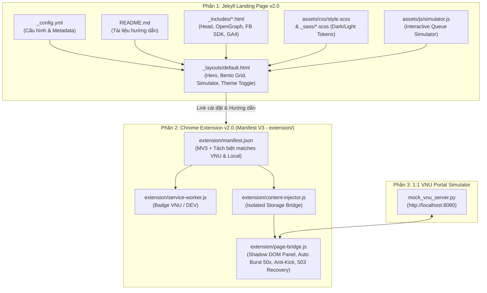

# Phân Tích Source Code & Kiến Trúc Dự Án AutoDKMH (Auto Đăng Ký Môn Học VNU v1.0 → v2.0)

Tài liệu này phân tích toàn diện mã nguồn của repository **AutoDKMH** (`d:\AutoDKMH`), bao gồm:
1. **Source code hiện tại (`HEAD` - nhánh `dev` — Phiên bản v2.0)**:
   - **Jekyll Landing Page v2.0**: Giao diện Dark/Light Mode (*Obsidian Slate & VNU Emerald*), tích hợp trình mô phỏng tương tác trực tiếp ([`assets/js/simulator.js`](file:///d:/AutoDKMH/assets/js/simulator.js)) và chuẩn hóa SEO / Facebook SDK.
   - **Chrome Extension Manifest V3 v2.0 ([`extension/`](file:///d:/AutoDKMH/extension/manifest.json))**: Kiến trúc 3 tầng chuẩn MV3 với Shadow DOM Floating Panel, cơ chế **Ghim bắn nền Auto** (mặc định `50` lần, tùy chỉnh nhanh `50` / `100` / `150` / `1`, `min = 1` – `max = 1000`), **Solution 1 (Proactive Anti-Kick Defense)** chống văng phiên & phạt queue, nội suy tự động `data-rowindex` cho các lớp đã đầy và phân tách môi trường độc lập giữa `dangkyhoc.vnu.edu.vn` và `localhost`.
   - **Localhost 1:1 VNU Portal Simulator ([`mock_vnu_server.py`](file:///d:/AutoDKMH/mock_vnu_server.py))**: Server giả lập 1:1 giao diện và toàn bộ kịch bản thực tế của cổng ĐKMH ĐHQGHN (`http://localhost:8080`).
2. **Source code Extension gốc trong lịch sử Git (commit `3af9670` - `AutoDKMHVNU.crx`)**: Gói Chrome Extension v1.0 từng được commit vào repo trước khi chuyển lên Chrome Web Store ở bản v1.1 – v1.3, đã được giải nén và deobfuscate để làm rõ cơ chế hoạt động gốc.

---

## 1. Tổng Quan Kiến Trúc Dự Án

Dự án phát triển qua 3 giai đoạn rõ rệt:
- **Giai đoạn 1 (`v1.0` - commit `3af9670`)**: Lưu trữ trực tiếp gói cài đặt tiện ích mở rộng trình duyệt `AutoDKMHVNU.crx` (Manifest V2).
- **Giai đoạn 2 (`v1.1` → `v1.3`)**: Phát hành extension lên **Chrome Web Store** (`fbnkkndphognnfnaoljphdijkcpkjmoc`) và xây dựng **Jekyll Landing Page** trên GitHub Pages.
- **Giai đoạn 3 (`v2.0` - hiện tại)**:
  - Nâng cấp toàn diện giao diện Landing Page sang hệ màu **Obsidian Slate & VNU Emerald** kèm **Interactive Simulator**.
  - Xây dựng lại Chrome Extension lên chuẩn **Manifest V3 (`extension/`)** với bảng điều khiển nổi cô lập bằng **Shadow DOM**, tích hợp **Auto Burst chạy nền (`50 / 100 / 150 / 1`, `1–1000`)**, **Chim Mồi (Canary Probe)**, **Giữ phiên 3 phút (Heartbeat)**, **Phanh khẩn cấp 0ms (Circuit Breaker)** và **Cứu hộ trang sập 503 / ASP.NET Error**.



---

## 2. Phân Tích Source Code Hiện Tại (Landing Page v2.0 & Extension MV3 v2.0)

### 2.1. Cấu trúc thư mục hiện tại

```text
d:\AutoDKMH\
├── .gitattributes                  # Cấu hình GitHub Linguist
├── _config.yml                     # File cấu hình chính của Jekyll
├── README.md                       # Nội dung hướng dẫn sử dụng chi tiết
├── Agents.md                       # Tài liệu kiến trúc & phân tích mã nguồn dự án
├── demo.png                        # Ảnh chụp màn hình giao diện tool
├── mock_vnu_server.py              # Server giả lập 1:1 cổng dangkyhoc.vnu.edu.vn (Port 8080)
├── _layouts/
│   └── default.html                # Layout HTML v2.0 (Hero 2 cột, Interactive Demo, Bento Grid)
├── _includes/
│   ├── head.html                   # Thẻ <head>, meta SEO, FOUC-free Theme Script, CSS
│   ├── opengraph.html              # Các thẻ meta Open Graph (Facebook/Social sharing)
│   ├── facebook-like.html          # Khởi tạo Facebook JS SDK duy nhất (#fb-root)
│   ├── facebook-comment.html       # Plugin bình luận Facebook (đã loại bỏ trùng lặp SDK)
│   └── googleanalytics.html        # Tích hợp Google Analytics 4 (gtag.js)
├── assets/
│   ├── css/
│   │   └── style.scss              # Entrypoint SCSS của Jekyll
│   └── js/
│       └── simulator.js            # Mô phỏng tương tác Auto DKMH v2.0 ngay trên Landing Page
├── _sass/
│   ├── jekyll-theme-cayman.scss    # Style hệ thống Obsidian Slate & VNU Emerald + Glassmorphism
│   ├── variables.scss              # Design tokens & CSS Custom Properties (Dark/Light Mode)
│   ├── normalize.scss              # Reset CSS chuẩn hóa giữa các trình duyệt
│   └── rouge-github.scss           # Highlight cú pháp code block
└── extension/                      # Chrome Extension v2.0 (Manifest V3)
    ├── manifest.json               # Cấu hình MV3, phân tách matches giữa VNU và Localhost
    ├── service-worker.js           # Quản lý trạng thái tab & hiển thị Badge (VNU / DEV)
    ├── content-injector.js         # Cầu nối lưu trữ chrome.storage.local theo môi trường
    ├── page-bridge.js              # Bảng điều khiển Shadow DOM, Auto Burst, Chim Mồi, Anti-503
    └── icons/                      # Bộ icon 16x16, 48x48, 128x128
```

### 2.2. Chi tiết Chrome Extension v2.0 (`extension/`)

#### a) Phân tách môi trường `dangkyhoc.vnu.edu.vn` và `localhost`
- **[`extension/manifest.json`](file:///d:/AutoDKMH/extension/manifest.json)**: Tách riêng 2 khối `content_scripts` cho cổng thật (`*://*.dangkyhoc.vnu.edu.vn/dang-ky-mon-hoc*`, `/dang-nhap*`, `/*`) và môi trường test (`http://localhost/dang-ky-mon-hoc*`, `/dang-nhap*`).
- **[`extension/service-worker.js`](file:///d:/AutoDKMH/extension/service-worker.js)**: Tự động gắn nhãn **`VNU`** (xanh lá `#10B981`) khi mở cổng thật và **`DEV`** (vàng `#F59E0B`) khi mở trên `localhost`.
- **[`extension/content-injector.js`](file:///d:/AutoDKMH/extension/content-injector.js)**: Cô lập danh sách môn học trong `chrome.storage.local` thành 2 khóa riêng (`autodkmh_v2_queue_vnu` và `autodkmh_v2_queue_local`) để dữ liệu test không bao giờ ghi đè danh sách môn thật.

#### b) Các cơ chế cốt lõi trong [`extension/page-bridge.js`](file:///d:/AutoDKMH/extension/page-bridge.js)
1. **Ghim Bắn Nền Tích Hợp Trong Auto (`globalBurstCount`)**:
   - Trên bảng môn học VNU (`#divDSDK`), mỗi dòng hiển thị gọn gàng mã số `#rowIndex` và duy nhất nút **`+Auto`**.
   - Khi chạy Auto hoặc Đăng Ký Nhanh, cơ chế bắn nền tự động nhân bản gói tin mặc định **`50` lần/môn** (bắn theo từng đợt sóng 4 luồng song song `BURST_CONCURRENCY = 4`).
   - Trên bảng điều khiển có thanh chọn nhanh **`🎯 Ghim môn: [50] [100] [150] [1]`** kèm ô nhập số trực tiếp (`min = 1`, `max = 1000`).
   - **Chốt đơn tức thì (Instant Early-Commit)**: Ngay khoảnh khắc 1 gói tin trong đợt bắn trả về `200 OK` (`SELECTED`), tool ngắt toàn bộ các gói tin dư thừa còn lại và gọi thẳng `POST /xac-nhan-dang-ky/1` để ghi nhận môn học vào tài khoản.
2. **Solution 1 — Phòng vệ chủ động chống văng phiên & phạt Queue (`Quay lại sau: Xphút`)**:
   - **`🐦 Chim Mồi (Canary Probe)`**: Khi cổng đang khóa (`Đang khóa đăng ký học` / `Ngoài thời hạn đăng ký!`) hoặc nghẽn `503`, chỉ bắn thăm dò đúng 1 gói tin của môn đầu tiên và giữ các môn sau ở trạng thái `🛡️ Chờ Chim Mồi`.
   - **`💓 Giữ phiên 3p (Silent Session Heartbeat)`**: Tự động gửi request `GET` nhẹ mỗi 3 phút (kèm jitter) để nuôi sống cookie `ASP.NET_SessionId`.
   - **`🛑 Phanh Khẩn Cấp (0ms Circuit Breaker)`**: Dừng Auto ngay lập tức ở gói tin đầu tiên nếu phát hiện bị redirect về `/dang-nhap` hoặc đạt giới hạn người truy cập tối đa.
3. **Nội suy tự động `data-rowindex` cho các lớp đã đầy (`ensureAllRowsHaveRowIndex()`)**:
   - Khi một lớp học phần đã đầy (`61/60`, `60/60`, `48/48`) hoặc ngoài thời hạn đăng ký, cổng VNU ẩn thẻ `<input class="order">`. Hàm `ensureAllRowsHaveRowIndex()` tự động nội suy mã số thứ tự từ các dòng liền kề và gắn nút `+Auto` đầy đủ cho cả các lớp đã đầy.
4. **Cứu hộ trang sập `503 Service Unavailable` & `ASP.NET Error` (`mount503RecoveryOverlay()`)**:
   - Nhận diện cả lỗi tầng IIS (`The service is unavailable.`) lẫn lỗi tầng ASP.NET MVC (`Error. An error occurred while processing your request.`), hiển thị bảng cứu hộ tự động ping nhẹ mỗi 3 giây và tự tải lại trang ngay khi server VNU thông cổng.

---

## 3. Phân Tích Source Code Chrome Extension Gốc (Giải Mã Từ Git History `3af9670`)

Trong commit `3af9670` (`v1.0`), file `AutoDKMHVNU.crx` chứa mã nguồn gốc của tiện ích mở rộng (Manifest V2):
- `manifest.json`: Khai báo cấu hình Chrome Extension (Manifest V2).
- `background.js`: Quản lý trạng thái `pageAction` icon.
- `run.js`: Content script chèn thẻ `<script src="chrome-extension://.../content.js">` vào DOM.
- `content.js`: Ghi đè `$registrationAvailable = 'true'`, vô hiệu hóa `App.blockUI` và `CheckConflict`, hiển thị `data-rowindex` cạnh `.order` và gửi chuỗi `$.ajax` đồng bộ (`async: false`) tới `/chon-mon-hoc/{rowIndex}/1/{$dsdkMod}` và `/xac-nhan-dang-ky/1`.

---

## 4. Bảng Tổng Hợp Cải Tiến Kỹ Thuật (v1.3 → v2.0)

| Hạng mục | Bản cũ (v1.0 – v1.3) | Bản nâng cấp (v2.0) |
| :--- | :--- | :--- |
| **Landing Page** | Theme Cayman sáng tĩnh, nạp trùng 2 lần Facebook SDK & `#fb-root`, lệch `fb:app_id`. | Hệ màu **Obsidian Slate & VNU Emerald**, nút chuyển Dark/Light không chớp trắng, tích hợp **Interactive Queue Simulator** và đồng bộ 1 lần nạp FB SDK. |
| **Kiến trúc Extension** | Manifest V2 (đã ngừng hỗ trợ), dùng `$.ajax({ async: false })` gây đơ cứng giao diện trình duyệt. | **Manifest V3**, bất đồng bộ 100% với `fetch` + `AbortController` timeout 6s, giao diện **Shadow DOM** cô lập CSS hoàn toàn. |
| **Cơ chế săn slot** | Bắn tuần tự từng môn 1 lần, lớp Full bị mất ô checkbox nên phải tự đoán mò mã số lân cận. | **Auto Bắn Nền mặc định 50 lần/môn** (tùy chỉnh `50 / 100 / 150 / 1`, `min 1 – max 1000`), tự động nội suy `rowindex` cho lớp Full và tự chốt đơn ngay khi trúng slot. |
| **Chống sập & Văng phiên** | Dễ bị treo khi gặp lỗi 503 hoặc bị server VNU hủy phiên, phạt chờ queue 5–30 phút. | Tích hợp **🐦 Chim Mồi (Canary)**, **💓 Giữ phiên 3p**, **🛑 Phanh khẩn cấp 0ms** và **🔄 Khung cứu hộ tự động khi sập 503 / ASP.NET Error**. |
