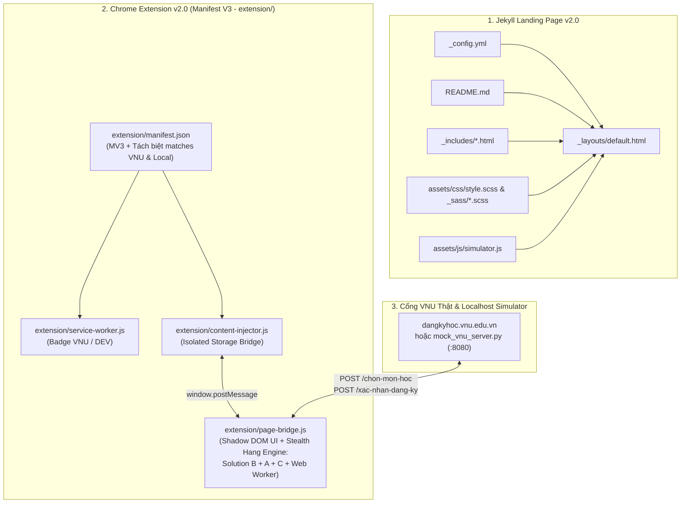
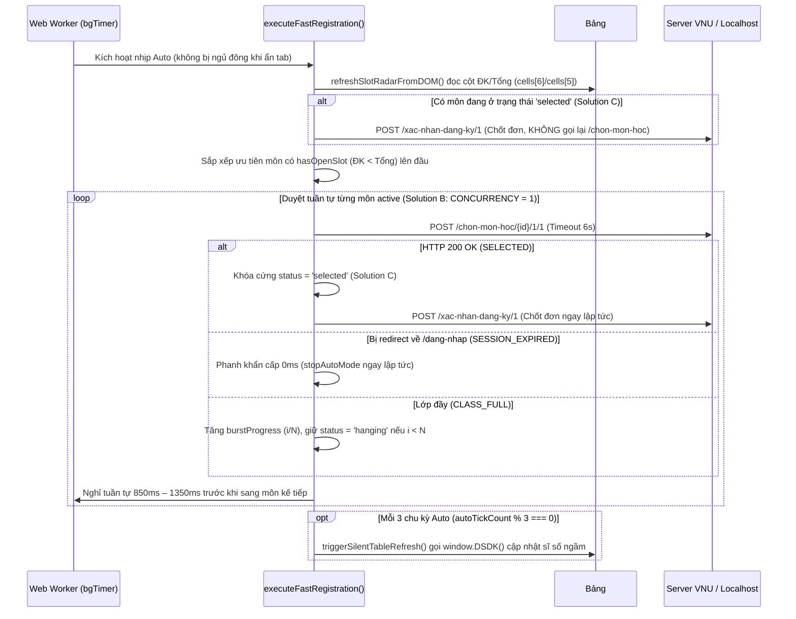

# Kiến Trúc, Cấu Trúc Dữ Liệu & Logic Vận Hành Dự Án AutoDKMH v2.0

Tài liệu này mô tả chính xác kiến trúc, cấu trúc dữ liệu và luồng xử lý hiện hành của dự án **AutoDKMH v2.0** (`d:\AutoDKMH`), bao gồm:
1. **Chrome Extension Manifest V3 v2.0 ([`extension/`](file:///d:/AutoDKMH/extension/manifest.json))**: Bảng điều khiển nổi cô lập bằng **Shadow DOM**, vận hành trên lõi **Stealth Background Hang Engine (`Solution B + Solution A + Solution C + Web Worker Background Timer`)** kết hợp **Giữ phiên ngầm 3 phút**, **Phanh khẩn cấp 0ms** và **Cứu hộ trang sập 503 / ASP.NET Error**.
2. **Localhost 1:1 VNU Portal Simulator ([`mock_vnu_server.py`](file:///d:/AutoDKMH/mock_vnu_server.py))**: Server giả lập 1:1 giao diện và các kịch bản thực tế của cổng ĐKMH ĐHQGHN (`http://localhost:8080`).
3. **Jekyll Landing Page v2.0 ([`_layouts/default.html`](file:///d:/AutoDKMH/_layouts/default.html))**: Giao diện Dark/Light Mode (*Obsidian Slate & VNU Emerald*), tích hợp trình mô phỏng tương tác trực tiếp ([`assets/js/simulator.js`](file:///d:/AutoDKMH/assets/js/simulator.js)) và chuẩn hóa SEO / Facebook SDK.

---

## 1. Sơ Đồ Kiến Trúc Tổng Thể



### Cấu trúc thư mục dự án

```text
d:\AutoDKMH\
├── _config.yml                     # Cấu hình Jekyll Landing Page
├── README.md                       # Tài liệu hướng dẫn người dùng
├── Agents.md                       # Tài liệu kiến trúc, cấu trúc dữ liệu & logic hiện hành
├── mock_vnu_server.py              # Server giả lập 1:1 cổng dangkyhoc.vnu.edu.vn (Port 8080)
├── _layouts/
│   └── default.html                # Layout HTML v2.0 (Hero, Interactive Demo, Bento Grid)
├── _includes/                      # Head, OpenGraph, Facebook SDK, Google Analytics 4
├── _sass/                          # Hệ màu Obsidian Slate & VNU Emerald (Dark/Light tokens)
├── assets/
│   ├── css/style.scss              # Entrypoint SCSS
│   └── js/simulator.js             # Mô phỏng tương tác trên Landing Page
└── extension/                      # Chrome Extension v2.0 (Manifest V3)
    ├── manifest.json               # Cấu hình MV3, phân tách matches giữa VNU và Localhost
    ├── service-worker.js           # Quản lý trạng thái tab & hiển thị Badge (VNU / DEV)
    ├── content-injector.js         # Cầu nối lưu trữ chrome.storage.local theo môi trường
    ├── page-bridge.js              # Shadow DOM UI & Stealth Background Hang Engine
    └── icons/                      # Bộ icon 16x16, 48x48, 128x128
```

---

## 2. Cấu Trúc Dữ Liệu Đang Sử Dụng (`Data Structures`)

### 2.1. Phân tách khóa lưu trữ trong `chrome.storage.local` ([`extension/content-injector.js`](file:///d:/AutoDKMH/extension/content-injector.js))
Để dữ liệu thử nghiệm trên `localhost` không bao giờ ghi đè danh sách môn thật trên cổng ĐHQGHN, `content-injector.js` phân nhánh khóa lưu trữ dựa theo `window.location.hostname`:

| Môi trường | Điều kiện nhận diện | Khóa trong `chrome.storage.local` | Badge trên Icon Extension |
| :--- | :--- | :--- | :--- |
| **Cổng VNU thật** | `*.dangkyhoc.vnu.edu.vn` | `autodkmh_v2_queue_vnu` | `VNU` (`#10B981`) |
| **Localhost Sandbox** | `localhost` hoặc `127.0.0.1` | `autodkmh_v2_queue_local` | `DEV` (`#F59E0B`) |

### 2.2. Cấu trúc đối tượng môn học `CourseQueueItem` trong mảng `queue` ([`extension/page-bridge.js`](file:///d:/AutoDKMH/extension/page-bridge.js))
Mảng `queue` trong `page-bridge.js` lưu danh sách các lớp học phần cần đăng ký. Mỗi phần tử có cấu trúc dữ liệu chuẩn như sau:

```ts
interface CourseQueueItem {
  id: string;            // Mã số dòng (data-rowindex) gửi lên API /chon-mon-hoc/{id}/{regMode}/{dsdkMod}, VD: "926"
  code: string;          // Mã lớp học phần hiển thị trên bảng, VD: "UET.CS2046 7"
  name: string;          // Tên môn học, VD: "Trí tuệ nhân tạo"
  status: CourseStatus;  // Trạng thái hiện tại trong máy trạng thái (State Machine)
  pingMs: number;        // Độ trễ phản hồi HTTP gần nhất tính bằng mili-giây (ms)
  attempts: number;      // Tổng số request POST /chon-mon-hoc đã gửi trong phiên
  burstCount: number;    // Tổng số lượt treo săn ngầm tối đa cho môn này (Min: 1, Max: 1000, Mặc định: 50)
  burstProgress: number; // Tiến độ lượt treo hiện tại (0 -> burstCount)
  slotText: string;      // Chuỗi sĩ số đọc từ cột ĐK/Tổng trên DOM (Solution A), VD: "60/60" hoặc "57/60"
  hasOpenSlot: boolean;  // Cờ báo lớp đang còn chỗ trống (enrolled < maxSlots) để ưu tiên lên đầu hàng đợi
}
```

### 2.3. Máy trạng thái môn học (`CourseStatus State Machine`)
Mỗi môn học trong `queue` chuyển đổi qua 8 trạng thái rõ ràng:

| Giá trị `status` | Hiển thị trên Badge UI | Ý nghĩa & Hành vi trong Engine |
| :--- | :--- | :--- |
| `'idle'` | `⏳ Sẵn sàng` / `⏳ Sẵn sàng (i/N)` | Môn mới thêm vào hoặc vừa được đặt lại, sẵn sàng điểm danh ở chu kỳ tiếp theo. |
| `'sending'` | `🔄 Điểm danh i/N...` | Đang gửi gói tin đơn lẻ `POST /chon-mon-hoc/...` của chu kỳ hiện tại (khóa ô nhập `burst-input`). |
| `'hanging'` | `🛰️ Treo i/N (ping ms)` | Lớp hiện đang đầy (`CLASS_FULL`) nhưng chưa chạy hết số lượt (`burstProgress < burstCount`); giữ trạng thái treo ngầm để điểm danh tiếp ở chu kỳ sau. |
| `'selected'` | `📌 Đã găm giỏ (ping ms)` | **Solution C**: Đã bắt dính slot vào giỏ tạm trên Session. Khóa cứng không bao giờ gọi lại `/chon-mon-hoc` trên môn này nữa, chỉ gọi `/xac-nhan-dang-ky/1` để chốt đơn. |
| `'confirmed'` | `✅ Đã ghi nhận (ping ms)` | Đã gọi `POST /xac-nhan-dang-ky/1` thành công và ghi nhận môn học vào cơ sở dữ liệu chính thức. |
| `'full'` | `⏸ Đủ N/N lượt` | Đã chạy đủ số lượt treo tối đa (`burstProgress >= burstCount`) mà lớp vẫn đầy. Tự mở lại khi bấm `🔁 Auto`, `↺` hoặc tăng số lượt `🎯`. |
| `'overload'` | `🔥 Cổng khóa/503 (i/N)` | Server trả về HTTP `503`, lỗi HTML ASP.NET hoặc thông báo khóa cổng (`Đang khóa đăng ký học` / `Ngoài thời hạn đăng ký!`). |
| `'expired'` | `❌ Văng phiên!` | Phát hiện bị redirect về `/dang-nhap` hoặc hiện hàng đợi `Quay lại sau:`. Kích hoạt phanh khẩn cấp dừng toàn bộ Auto ngay lập tức. |

> **Quy tắc chuẩn hóa khi lưu (`saveQueue`)**: Khi ghi xuống `chrome.storage.local`, các trạng thái động tạm thời (`'sending'`, `'hanging'`) được chuyển về `'idle'`, giữ nguyên `burstCount`, `burstProgress`, `slotText`, `hasOpenSlot` và đặc biệt giữ nguyên `'selected'` / `'confirmed'`.

### 2.4. Cấu trúc bộ đếm nền `bgTimer` (`Web Worker Timer Map`)
Trong [`createBackgroundWorkerTimer()`](file:///d:/AutoDKMH/extension/page-bridge.js#L24-L108), bộ đếm thời gian chạy trên một `Worker` khởi tạo từ `Blob` độc lập với luồng giao diện chính:
- **`callbacks: Map<string, Function>`**: Ánh xạ định danh bộ đếm (`'autoTick'`, `'heartbeat'`, `'sleep_<id>'`) tới hàm callback trong `page-bridge.js`.
- **`timers: Map<string, { type: 'timeout' | 'interval', ref: number }>`**: Lưu bên trong bộ nhớ của Web Worker, gửi thông điệp `{ id }` qua `self.postMessage` khi đến hạn. Nếu trang web chặn `blob:` Worker bằng CSP, `bgTimer` tự động fallback sang `window.setTimeout` / `window.setInterval`.

---

## 3. Chi Tiết Logic Vận Hành Trong [`extension/page-bridge.js`](file:///d:/AutoDKMH/extension/page-bridge.js)

### 3.1. Mở khóa giới hạn Client, Chọn môn ở trạng thái "Ngoài thời hạn đăng ký!" & Nội suy `data-rowindex`
1. **Ghi đè biến toàn cục của cổng VNU** ([dòng `176–196`](file:///d:/AutoDKMH/extension/page-bridge.js#L176-L196)):
   - Gán `window.$registrationMode = '1'` và `window.$registrationAvailable = 'true'`.
   - Vô hiệu hóa `window.App.blockUI` (chống khóa màn hình chờ) và `window.CheckConflict` (bỏ qua bước kiểm tra trùng lịch phía client).
2. **Mở khóa chọn môn khi ở trạng thái `"Ngoài thời hạn đăng ký!"` ([`ensureAllRowsHaveRowIndex()`](file:///d:/AutoDKMH/extension/page-bridge.js#L977-L1046) & [`enhanceCourseTable()`](file:///d:/AutoDKMH/extension/page-bridge.js#L1178-L1254))**:
   - Khi một lớp học phần đã đầy (`60/60`, `61/60`, `48/48`) hoặc cổng đang hiển thị **`"Ngoài thời hạn đăng ký!"`**, cổng VNU ẩn toàn bộ thẻ `<input type="checkbox" class="order" data-rowindex="...">` và ẩn nút `💾 Ghi nhận`.
   - Hàm `ensureAllRowsHaveRowIndex()` kết hợp bộ nhớ ánh xạ `autodkmh_v2_rowindex_map` (`courseCode -> rowIndex`) với quét nội suy 2 chiều để giữ nguyên mã số dòng chính xác cho 100% lớp học phần.
   - Hàm `enhanceCourseTable()` tự động **khôi phục ô checkbox `<input type="checkbox" class="order">`** bị ẩn, gắn huy hiệu `#rowIndex`, nút **`+Auto`** trên mọi dòng, đồng thời [`unlockOutOfTimeConfirmButton()`](file:///d:/AutoDKMH/extension/page-bridge.js#L1149-L1176) tự động chèn lại nút **`💾 Ghi nhận`** cạnh nhãn `"Ngoài thời hạn đăng ký!"` để người dùng vẫn chọn và đăng ký môn bình thường.

### 3.2. Stealth Background Hang Engine (`Solution B + Solution A + Solution C + Web Worker`)



1. **Web Worker Background Timer ([`createBackgroundWorkerTimer`](file:///d:/AutoDKMH/extension/page-bridge.js#L24-L108))**:
   - Đảm bảo cả vòng lặp **Auto** ([`scheduleNextAutoTick`](file:///d:/AutoDKMH/extension/page-bridge.js#L1393-L1410)), **Giữ phiên 3 phút** ([`startHeartbeat`](file:///d:/AutoDKMH/extension/page-bridge.js#L768-L794)) và hàm [`sleep`](file:///d:/AutoDKMH/extension/page-bridge.js#L112-L117) hoạt động chính xác ngay cả khi người dùng chuyển sang tab khác hoặc thu nhỏ cửa sổ trình duyệt.
2. **Solution A — Radar soi sĩ số thụ động ([`getRowSlotInfo`](file:///d:/AutoDKMH/extension/page-bridge.js#L817-L834) & [`refreshSlotRadarFromDOM`](file:///d:/AutoDKMH/extension/page-bridge.js#L836-L845))**:
   - Đọc trực tiếp cột `Tổng` (`cells[5]`) và `ĐK` (`cells[6]`) của từng dòng trên bảng `#divDSDK`.
   - Hiển thị huy hiệu sĩ số (`60/60`, hoặc xanh lá `57/60` khi `ĐK < Tổng`) ngay trên thẻ môn.
   - Tự động sắp xếp các môn có `hasOpenSlot === true` lên đầu hàng đợi trong [`executeFastRegistration()`](file:///d:/AutoDKMH/extension/page-bridge.js#L1324-L1329) và làm mới nhẹ bảng môn học mỗi 3 chu kỳ Auto qua [`triggerSilentTableRefresh()`](file:///d:/AutoDKMH/extension/page-bridge.js#L847-L861).
3. **Solution B — Điểm danh tuần tự chống khóa Session ([`processCourseItem`](file:///d:/AutoDKMH/extension/page-bridge.js#L1216-L1281))**:
   - Server ASP.NET MVC khóa độc quyền `HttpContext.Session` theo từng `ASP.NET_SessionId`. Việc bắn dồn dập nhiều request song song sẽ gây `Session Lock Contention` và làm văng phiên đăng nhập.
   - `processCourseItem()` chỉ gửi **đúng 1 gói tin đơn lẻ cho mỗi môn trong 1 chu kỳ** (`CONCURRENCY = 1`), kèm khoảng nghỉ tuần tự `850ms – 1350ms` (`INTER_COURSE_MIN_GAP_MS + jitter`) giữa các môn.
   - Mỗi môn có ô nhập **`🎯 [1 – 1000]`** (mặc định `50`) quy định tổng số lượt treo ngầm. Khi lớp đầy, môn giữ trạng thái `'hanging'` (`🛰️ Treo i/N`) và tăng dần `burstProgress` qua từng chu kỳ cho đến khi bắt được slot hoặc đạt đủ `burstCount`.
4. **Solution C — Khóa cứng môn đã vào giỏ ([`commitSelectedCoursesImmediately`](file:///d:/AutoDKMH/extension/page-bridge.js#L1167-L1213))**:
   - Endpoint `/chon-mon-hoc/{rowIndex}/1/1` của cổng VNU hoạt động theo cơ chế toggle: nếu môn đã nằm trong giỏ tạm mà gọi lại `/chon-mon-hoc`, server có thể hiểu là bỏ chọn môn.
   - Do đó, ngay khi một môn trả về `SELECTED`, trạng thái của môn được khóa cứng ở `'selected'` (`📌 Đã găm giỏ`) và gọi ngay `POST /xac-nhan-dang-ky/1`. Nếu bước xác nhận bị nghẽn mạng, các chu kỳ tiếp theo **tuyệt đối không gọi lại `/chon-mon-hoc`** trên môn đó mà chỉ gọi lại `/xac-nhan-dang-ky/1` cho tới khi chuyển sang `'confirmed'` (`✅ Đã ghi nhận`).

### 3.3. Phòng vệ phiên đăng nhập & Cứu hộ lỗi 503
- **Giữ phiên ngầm 3 phút ([`startHeartbeat`](file:///d:/AutoDKMH/extension/page-bridge.js#L768-L794))**: Tự động chạy ngầm qua `bgTimer` mỗi `180,000ms + jitter` (khi không chạy Auto) để gửi request `GET /dang-ky-mon-hoc-nganh-1` nuôi sống cookie `ASP.NET_SessionId`.
- **Phanh khẩn cấp 0ms (`Circuit Breaker` — [`isResponseSessionExpired`](file:///d:/AutoDKMH/extension/page-bridge.js#L160-L171))**: Kiểm tra tức thì cờ `response.redirected` về `/dang-nhap` hoặc nội dung chứa `Đăng nhập hệ thống` / `Quay lại sau:` / `giới hạn số người truy cập tối đa`. Nếu phát hiện, lập tức gọi `stopAutoMode()` ngay ở gói tin đó để tránh bị cộng dồn thời gian phạt hàng đợi.
- **Khung cứu hộ trang sập 503 ([`mount503RecoveryOverlay`](file:///d:/AutoDKMH/extension/page-bridge.js#L204-L273))**: Khi trang web trả về lỗi trắng `The service is unavailable.` hoặc `An error occurred while processing your request.` (không có `#divDSDK`), tự động hiển thị khung cứu hộ cho phép ping ngầm mỗi 3 giây và tự tải lại trang ngay khi server VNU thông cổng.
